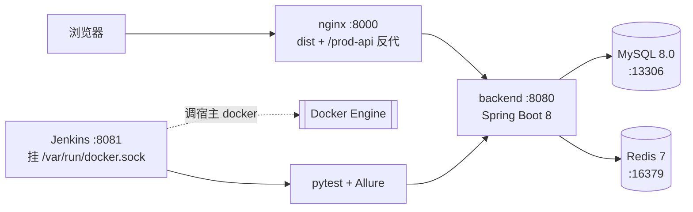

# ruoyi-testops · 若依后台管理系统 接口自动化测试 + Docker + Jenkins

> 被测系统：[RuoYi-Vue](https://gitee.com/y_project/RuoYi-Vue)（MIT）。本仓库**不含**若依源码，构建时在容器内 `git clone --depth 1`。

**一句话**：用 Docker Compose 一键复现完整测试环境，用 pytest + requests 搭 4 层接口自动化框架（配置 / 接口封装 / 用例 / 数据），用 Jenkins 声明式 Pipeline 串起「构建 → 起环境 → 冒烟 → 回归 → Allure 报告」。

状态：🚧 第 1 周（环境容器化）进行中 · 计划 2026-12-06 收尾

## 架构



## 快速开始

```bash
cp .env.example .env
docker network create ruoyi-net
./scripts/up.sh          # 目标：8 分钟内可登录
# http://localhost:8000  admin / admin123
```

（D5 完成后本节给出实测耗时与截图）

## 用例统计

| 优先级 | 计划 | 已实现 | 最近一次全量通过率 |
|---|---|---|---|
| P0 | 28 | 0 | — |
| P1 | 51 | 0 | — |
| P2 | 31 | 0 | — |
| 合计 | 110 | 0 | — |

## 目录结构

```
ruoyi-testops/
├── docker-compose.yml      # 应用栈：mysql / redis / backend / frontend
├── scripts/                # up.sh / down.sh
├── deploy/                 # 三个多阶段 Dockerfile + nginx.conf + 初始化 SQL
├── jenkins/                # Jenkins 镜像、独立 compose、Jenkinsfile
├── tests/                  # api(接口层) / cases(用例层) / data(数据层) / utils(工具)
├── docs/                   # 接口清单 / 用例设计 / 踩坑 / 缺陷 / 面试问答 / 进度日志
└── requirements.txt
```

## 版本锁定

| 组件 | 版本 |
|---|---|
| RuoYi-Vue | master（3.8.x） |
| MySQL | 8.0（utf8mb4，`--default-time-zone=+08:00`） |
| Redis | 7-alpine |
| JDK | 8（运行 `eclipse-temurin:8-jre`，构建 `maven:3.9-eclipse-temurin-8`） |
| Node | 16-alpine（前端构建） |
| Nginx | 1.25-alpine |
| Jenkins | `jenkins/jenkins:lts-jdk17` |
| Python（本地 / CI） | 3.12 / 3.11（Jenkins 基础镜像 Debian 12 自带） |
| pytest | 8.3.3 |

## 两个核心决策（面试会被追问"为什么"）

1. **编译过程全部收进多阶段 Dockerfile**，Jenkins 镜像里不装 Maven/Node —— 宿主零 JDK/Maven/Node 依赖，构建可复现。
2. **不用 bind mount，配置与初始化 SQL 一律 `COPY` 进镜像** —— Jenkins 通过 `docker.sock` 调**宿主** Docker，bind mount 的路径由宿主解析，容器内路径在宿主上不存在会静默建成空目录（症状：容器起来了但库里没表、nginx 403）。

## 已知限制

- Jenkins 挂 `/var/run/docker.sock` + `user: root`，等于把宿主 root 权限交给了容器内进程。这是学习项目的妥协，生产应换 rootless docker / DinD / 独立 agent。
- 测试环境为「可重建」定位：`docker compose down -v` 后数据全丢，登录验证码通过初始化 SQL 关闭。
- 本地 Python 3.12 / CI 容器内 3.11（基础镜像自带，未额外对齐）：用例不依赖两个版本的行为差异，若出现「仅 CI 复现」的问题，优先怀疑版本或环境而非业务逻辑。

## 来源与许可

本项目代码 MIT。被测系统 RuoYi-Vue 亦为 MIT，版权归其作者（若依 / y_project）。
